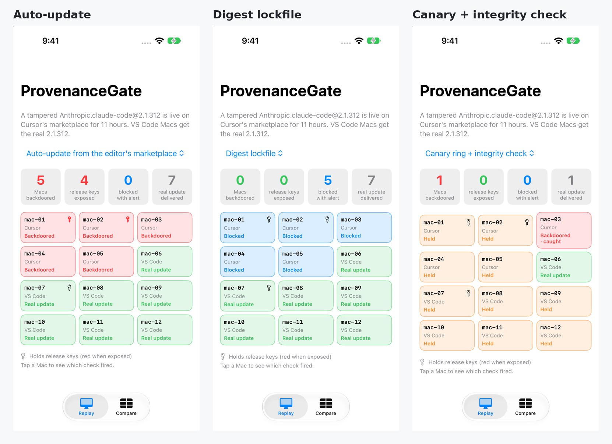

# ProvenanceGate

**Replay a tampered AI coding tool update against your team's install policy, and see which check actually stops it.**

On 29 October 2026 a maliciously modified build of Anthropic's Claude Code extension was served by Cursor's extension marketplace for about 11 hours. It carried the right publisher ID and ordinary version numbers. This repo rebuilds that incident as a deterministic replay in Swift and runs it against seven install policies on a constructed 12-Mac iOS team.

Article: [The Backdoored Claude Code Extension Passed Every Name Check. In My Replay, Only a Digest Stopped It Everywhere.](https://medium.com/@er.rajatlakhina/the-backdoored-claude-code-extension-passed-every-name-check-f3a042d1a8f2)



## What it shows

| Policy | Macs backdoored | Key holders hit | Secrets exposed | Blocked + alert | Real update delivered |
|---|---:|---:|---:|---:|---:|
| Auto-update from the editor's marketplace | 5 | 2 | 4 | 0 | 7 |
| Publisher allowlist | 5 | 2 | 4 | 0 | 7 |
| Version pin (bumped to 2.1.312) | 5 | 2 | 4 | 0 | 7 |
| Digest lockfile | 0 | 0 | 0 | 5 | 7 |
| Canary ring + integrity check | 1 | 0 | 0 | 0 | 1 |
| Release keys in CI only | 5 | 2 | 0 | 0 | 7 |
| Digest lockfile + canary + keys in CI | 0 | 0 | 0 | 1 | 1 |

Every number above is asserted in `Tests/ProvenanceGateTests`.

The publisher allowlist and the version pin can't tell the tampered build from the real one, because both read strings the uploader typed. A sha256 lockfile, taken from the build you reviewed on the publisher's own channel, is the only single check that sees the bytes.

## The core check

```swift
if let lockfile = policy.lockfile {
    guard let entry = lockfile.entry(for: identity.id) else {
        return .block(.notInLockfile(identity.id))
    }
    if entry.identity.version != identity.version {
        return .block(.versionNotPinned(expected: entry.identity.version, offered: identity.version))
    }
    if entry.sha256.lowercased() != artifact.sha256.lowercased() {
        return .block(.digestMismatch(expected: entry.sha256, offered: artifact.sha256, channel: artifact.channel))
    }
}
```

```swift
import ProvenanceGate

for result in Sample.replayAll() {
    print(result.policy.title, result.compromisedMachines, result.exposedSecrets)
}
```

## Layout

- `Sources/ProvenanceGate/Model.swift`: `ToolIdentity`, `Channel`, `Artifact`, `Machine`, `Secret`, `HostEffect`
- `Sources/ProvenanceGate/Policy.swift`: `Lockfile`, `RolloutPlan`, `SecretPlacement`, `InstallPolicy`
- `Sources/ProvenanceGate/AdmissionGate.swift`: the gate, which sees only identity, channel and digest
- `Sources/ProvenanceGate/Replay.swift`: `IncidentReplay`, ring ordering, canary halts, soak windows, blast radius
- `Sources/ProvenanceGate/SampleFleet.swift`: the constructed fleet, incident and seven policies
- `Demo.xcodeproj` + `Demo/DemoApp.swift`: SwiftUI app (Replay and Compare tabs; tap a Mac to see which check fired)

## How to run it

```bash
git clone https://github.com/rajatslakhina/agent-tool-provenance-article-demo.git
cd agent-tool-provenance-article-demo
open Demo.xcodeproj
```

Pick the **Demo** scheme and any iPhone Simulator, then Build & Run. No other setup: the app uses the library through a local package reference in the same repo.

Library only:

```bash
swift build
swift test
```

`Scripts/simulator-screenshots.sh` builds the app, installs it on a Simulator, launches four states with launch arguments (`-tab fleet|compare`, `-policy auto|digest|canary|…`), checks that the app is still running after each launch, and saves screenshots to `Demo/Screenshots/`.

## Verification status

- `swift build -Xswiftc -warnings-as-errors`: clean (macOS 27.2, Xcode 27.2, Swift 6.4.2)
- `swift test`: 20/20 passing
- Simulator: built with `xcodebuild` and run on an iPhone 18 Pro Simulator (iOS 27.2). Four launches, each confirmed running with a live PID, and real screenshots in `Demo/Screenshots/`. States were selected with launch arguments rather than UI taps.

## What's real and what's constructed

The incident's shape (publisher ID, version labels, 11-hour window, payload behaviour) follows public reporting: [CSO Online](https://www.csoonline.com/article/4243210/cursor-removes-malicious-claude-code-extension-after-ssh-backdoor-attempt.html) and [MIXED](https://mixed-news.com/en/cursor-claude-code-malicious-extension-backdoor-warning/). The fleet, digests and policies are invented for the replay. The replay assumes that the publisher's own channel shipped a genuine 2.1.312 the same day. This is not a scanner, and it contains no malicious code.

## License

MIT
